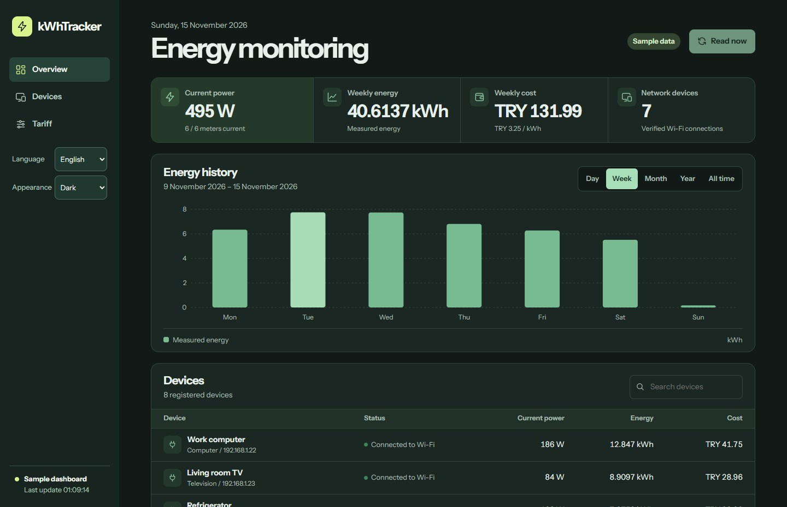

# kWhTracker

[Türkçe dokümantasyon](README.md)

kWhTracker is a self-hosted dashboard for Windows PC power, hardware sensors and uptime. A Windows collector sends readings to a Node.js panel, which stores them in SQLite. The dashboard supports English and Turkish, with light, dark and system themes.

> CPU and GPU sensors report component power. Use a compatible metering plug or wall meter to measure total power at the outlet. The dashboard estimates cost using recorded energy and the price you enter.



## Contents

- [Try the sample dashboard](#try-the-sample-dashboard)
- [Set up live readings on Windows](#set-up-live-readings-on-windows)
- [CPU and GPU data sources](#cpu-and-gpu-data-sources)
- [Use the dashboard](#use-the-dashboard)
- [Deploy to a remote server](#deploy-to-a-remote-server)
- [Shelly and local network options](#shelly-and-local-network-options)
- [Settings and files](#settings-and-files)
- [Security, maintenance and troubleshooting](#security-maintenance-and-troubleshooting)

## Try the sample dashboard

Install [Node.js 24.14 or later](https://nodejs.org/en/download). Open PowerShell on Windows or a terminal on another operating system.

```powershell
git clone https://github.com/umitturkmen/kWhTracker.git
cd kWhTracker
node --version
npm run demo
```

If you do not use Git, select **Code → Download ZIP** on GitHub and extract the folder. The project uses Node.js built-ins, so there is no `npm install` step.

Open [http://127.0.0.1:8787](http://127.0.0.1:8787) and select **English** in the sidebar. The sample dashboard includes devices, historical readings, charts and an example tariff. It listens on loopback, requires no login and keeps its data in memory. Press **Ctrl+C** in the terminal to stop it.

## Set up live readings on Windows

### 1. Configure the panel

Stop the demo. Run these commands from the project folder for a new installation. Reuse your existing `.env` if you already have a configured instance.

```powershell
$panelPassword = node -p "require('node:crypto').randomBytes(24).toString('hex')"
$agentToken = node -p "require('node:crypto').randomBytes(32).toString('hex')"
@(
  'PORT=8787'
  'BIND_HOST=127.0.0.1'
  'PANEL_USER=admin'
  "PANEL_PASSWORD=$panelPassword"
  "AGENT_TOKEN=$agentToken"
  'PC_ONLY=1'
) | Set-Content -Encoding ascii .env
npm start
```

Open the [local dashboard](http://127.0.0.1:8787). Sign in as `admin` using `PANEL_PASSWORD` from your local `.env`. Keep this file private. The dashboard starts out empty.

**Remember me** keeps this browser signed in for 30 days. To connect Google Authenticator, open **Account and security → Start setup**. Add the setup key to the app as **Time based**, then enter the six-digit code it generates. Future sign-ins ask for a current code after your password. The SQLite database also contains the authenticator key. Keep its backups private.

If you lose access to your codes, run `npm start -- --reset-authenticator` on the machine hosting the panel. For Docker, run `sudo docker compose --project-directory . -f deploy/compose.yml exec panel node src/server.mjs --reset-authenticator` from the project root. Resetting signs out all active sessions. Sign in with your password to connect the authenticator again.

### 2. Connect the Windows collector

Open a second PowerShell window in the same project folder.

```powershell
Copy-Item agent.config.example.json agent.config.json
notepad agent.config.json
```

The starting configuration looks like this.

```json
{
  "server": "http://127.0.0.1:8787",
  "intervalSeconds": 60,
  "pc": {
    "name": "My computer",
    "aida64": true,
    "nvidia": true
  }
}
```

- `server` is the panel's root URL. Use loopback HTTP on the same computer and HTTPS for a remote panel.
- `intervalSeconds` accepts 15–3600 seconds. The default of 60 sends one sample per minute.
- `pc.name` is the device label. The `pc.aida64` and `pc.nvidia` switches control those sources.
- If the panel and collector share a folder, they can share the existing `.env`. On a separate Windows machine, give the collector its own `.env` with only the same `AGENT_TOKEN`.

Send one real sample first.

```powershell
npm run agent -- --once
```

Check that the device and available readings appear. For continuous collection, leave `npm run agent` running or install the Windows scheduled task.

```powershell
powershell.exe -NoProfile -ExecutionPolicy RemoteSigned -File .\deploy\install-windows-task.ps1
```

The **Cihaz Takip PC** task starts when the current Windows user signs in and runs with ordinary user privileges. While that user is signed in, Windows checks every minute and starts the collector if the task has stopped. It runs one instance at a time. To pause collection, disable and stop the task in Task Scheduler. Stop any manually started collector with **Ctrl+C** before installing the task. Restart the task after changing the sampling interval.

## CPU and GPU data sources

| Source | Readings | Requirement |
| --- | --- | --- |
| Windows | CPU usage, memory use and hardware inventory | Windows PC collector |
| NVIDIA | GPU power, temperature, utilization, VRAM, clocks and fan percentage | Driver-provided `nvidia-smi.exe` and hardware support for each metric |
| CPU package counter | CPU package power and temperature where available | Signed PawnIO driver and the CPU reader task |
| AIDA64 | Sensors exported to the Registry, including supported CPU and GPU power values | AIDA64 running with Registry sharing enabled |
| Shelly Gen2+ | Instantaneous power and cumulative Wh reported by the meter | Energy metering and a compatible `Switch.GetStatus` channel |

### CPU package power without AIDA64

1. Install the [official signed PawnIO driver](https://pawnio.eu/).
2. Open PowerShell as Administrator and navigate to the project folder.
3. Run the installer.

```powershell
powershell.exe -NoProfile -ExecutionPolicy RemoteSigned -File .\deploy\install-cpu-reader.ps1
```

The script downloads a pinned LibreHardwareMonitor release and checks its SHA-256 digest. It tests a real CPU reading before registering **WattIz CPU Reader** to run at Windows startup. The reader refreshes a local sample roughly every 16 seconds. The regular collector sends the latest fresh sample. If the initial test returns no package power, check CPU and driver compatibility. [LibreHardwareMonitor](https://github.com/LibreHardwareMonitor/LibreHardwareMonitor)

### Additional sensors with AIDA64

In AIDA64, open **Preferences → Hardware Monitoring → External Applications** and enable **writing sensor values to Registry**. Select the sensors you want to see and apply the changes. Choose **CPU Package** and **GPU** if those power sensors are available. After AIDA64 closes, the dashboard keeps its last sample and displays its age. A fresh CPU-counter value takes priority over AIDA64 CPU power. NVIDIA supplies GPU power when AIDA64 does not provide it. [AIDA64 sensor sharing](https://www.aida64.com/user-manual/hardware-monitoring/external-applications)

## Use the dashboard

1. Open **Overview** to see current watts and the selected period's energy and cost.
2. In **Tariff**, enter the ₺/kWh price from your bill. The same price also applies to past periods. For example, an average of 150 W over four hours is 0.60 kWh. At ₺3.50/kWh, the estimated cost is ₺2.10.
3. Select your PC under **Devices** to see energy, uptime, session intervals, sensor charts and hardware inventory. Energy and uptime have separate period selectors. Use **Download CSV** to export the displayed energy period. Under **Hardware sensors**, choose the last 1, 6 or 12 hours. Hover, tap or focus a chart and use the arrow keys to inspect a reading and its timestamp.
4. Press **Read now** to request a new measurement. An online collector checks for requests about every four seconds under normal conditions.
5. Choose **Türkçe / English** and **System / Light / Dark** in the sidebar. Your browser remembers the choices across dashboard pages.

**Reading the numbers.** PC energy is calculated from consecutive power samples. Sleep, long gaps and sensor-source changes can leave gaps in the estimate. The live timer shows the time since Windows started. Recorded tracking time starts with the collector's first report. Gaps of up to four minutes count toward the same session unless a reboot is detected. Session boundaries are approximate at the sample cadence. Charts use Türkiye time. Raw trend samples are retained for 24 hours. Each chart shows the minimum, maximum and arithmetic mean for the selected range. **Cumulative statistics** remain in SQLite after older raw samples expire. Existing installations seed these totals from samples still available at upgrade time. Inventory is captured once and stays visible while the PC is offline. Drive occupancy comes from the inventory snapshot.

## Deploy to a remote server

Run the panel and SQLite on the server. Run the collector on the Windows PC. The following example uses Docker Compose on Linux and Caddy for HTTPS. Point your DNS record at your own server.

```bash
git clone https://github.com/umitturkmen/kWhTracker.git
cd kWhTracker
cp .env.example .env
openssl rand -hex 32
openssl rand -hex 32
```

Use the two different random values for `PANEL_PASSWORD` and `AGENT_TOKEN`. Set `PUBLIC_ORIGIN=https://energy.example.com` in `.env`, replacing the example hostname with yours.

```bash
sudo install -d -m 0750 -o 1000 -g 1000 data
sudo chmod 600 .env
sudo docker compose --project-directory . -f deploy/compose.yml up -d --build
sudo docker compose --project-directory . -f deploy/compose.yml ps
```

Compose exposes the panel on the host's `127.0.0.1:8787`. If Caddy runs directly on the same server, use a site block like this one.

```caddyfile
energy.example.com {
    reverse_proxy 127.0.0.1:8787
}
```

Validate and reload Caddy. Open the HTTPS hostname and sign in. Set the Windows collector's `server` to that HTTPS URL and copy the same `AGENT_TOKEN` into its own `.env`. Verify a single reading and then install the Windows task. The collector initiates outbound connections, so it needs no port forwarding on the PC side. [Caddy reverse proxy guide](https://caddyserver.com/docs/quick-starts/reverse-proxy)

To run without Docker, install Node.js 24.14 or later on the server, configure a local bind address and `PUBLIC_ORIGIN` in `.env`, and run `npm start`. For an always-on installation, start it with your service manager.

## Shelly and local network options

Use a separate collector configuration without the `pc` key and allow those reports on the panel by removing `PC_ONLY=1`. The supplied Compose file enforces PC-only mode. Set `PC_ONLY` to 0 in that file for Shelly reports or run the panel directly with Node.js.

```json
{
  "server": "http://127.0.0.1:8787",
  "intervalSeconds": 60,
  "network": { "mode": "none" },
  "meters": [
    {
      "ip": "192.168.1.50",
      "name": "Desktop power meter",
      "channel": 0,
      "passwordEnv": "SHELLY_PASSWORD"
    }
  ]
}
```

- Use a metering channel that returns `apower` and `aenergy.total` from `Switch.GetStatus`. The first reading establishes a baseline. Energy comes from subsequent differences in cumulative Wh. [Shelly Switch API](https://shelly-api-docs.shelly.cloud/gen2/ComponentsAndServices/Switch/)
- If the meter has a password, add `SHELLY_PASSWORD` to the collector's `.env`. Omit `passwordEnv` for a meter without a password.
- Choose `windows`, `openwrt` or `none` for `network.mode`. Windows shows the local neighbor cache. OpenWrt lists clients from the configured access point and requires `network.host`, `network.user`, a verified `known_hosts` entry and key-based SSH. Optionally set `network.identityFile`.
- Set `deviceMac` on the meter entry to associate readings with the measured network device. Meters that cover the same loads can double-count energy if you add their totals.

## Settings and files

| Setting | Purpose |
| --- | --- |
| `PORT` / `BIND_HOST` | Panel listener. Defaults to `127.0.0.1:8787`. |
| `PANEL_USER` / `PANEL_PASSWORD` | Dashboard login. Defaults to username `admin`. The password must have at least 16 characters. |
| `AGENT_TOKEN` | Separate collector token of at least 32 characters. Use the same value on the panel and collector. |
| `PUBLIC_ORIGIN` | Public HTTPS root URL. Used for origin checks on actions such as saving the tariff and requesting a reading. |
| `PC_ONLY` | Set to 1 to accept only PC reports. |
| `TRUST_PROXY` | Set to 1 only behind a reverse proxy you control. The Compose example enables it for the local reverse proxy. |
| `STALE_AFTER_SECONDS` | Freshness threshold baseline. Defaults to 180, minimum 60. Longer collection intervals extend the threshold. |
| `DB_PATH` | Panel database. Defaults to `data/cihaz-takip.sqlite`. |
| `queuePath` | Collector's local queue. Defaults to `data/toplayici.sqlite`. |
| `KWHTRACKER_LANG` | Set `en` for English in the panel server and collector terminals. Defaults to Turkish. The dashboard language is set in the browser. |
| `pc.hardware` | Manual entries for the first inventory. Each entry has `group`, `name` and `fields`. Each field has a `label` and `value`. |

### Add hardware manually

Before the first report, enter hardware details that Windows may not detect. The server retains the first inventory instead of overwriting it on every report.

```json
{
  "name": "My computer",
  "aida64": true,
  "nvidia": true,
  "hardware": [
    {
      "group": "Power supply",
      "name": "Example PSU",
      "fields": [{ "label": "Rated output", "value": "650 W" }]
    }
  ]
}
```

## Security, maintenance and troubleshooting

- The dashboard and collector use separate credentials. Use HTTPS for remote access. Inventory and network records may contain private device names and identifiers. Keep `.env`, `agent.config.json` and `data/` out of shared copies.
- During network outages the collector queues samples in a local SQLite file and sends them in order when the connection returns. The queue also holds the PC identifier and the first-inventory marker.
- **Update.** Stop the collector and panel, then update the code. Disable a scheduled collector task before stopping it. For Docker, rebuild using Compose with `up -d --build`. Run the task installer again for a scheduled collector, or restart a manual collector as usual. Check the latest reading on the panel.
- **Back up.** Use a SQLite-aware backup or stop the panel before copying the database files. Keep configuration and credentials in a restricted location.
- **Uninstall.** Stop and delete **Cihaz Takip PC** in Task Scheduler. If installed, stop and delete **WattIz CPU Reader** from an Administrator session. Check whether other applications use PawnIO before removing the shared driver.
- **The dashboard opens with no live data.** Run `npm run agent -- --once`. Check the root URL, system time, connection and `AGENT_TOKEN`. The demo only serves sample data.
- **CPU or GPU power is blank.** Check the CPU reader and PawnIO or AIDA64 sharing. For NVIDIA, run `nvidia-smi --query-gpu=power.draw --format=csv`. Unsupported readings can remain blank.
- **Read now or Tariff is rejected.** Verify that `PUBLIC_ORIGIN` exactly matches the HTTPS origin open in your browser.
- **Port already in use.** Stop the demo or previous panel. If you change ports, update the collector URL and any reverse proxy as well.
