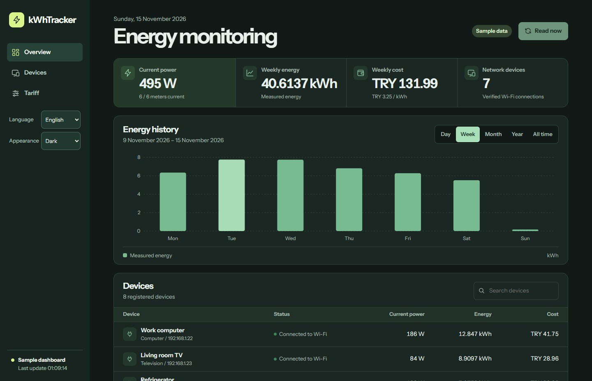

# kWhTracker

[English documentation](README.en.md)

kWhTracker, Windows bilgisayarının güç tüketimini, donanım sensörlerini ve açık kalma süresini kendi sunucunda çalışan bir web panelinde gösterir. Windows toplayıcısı veriyi belirli aralıklarla gönderir. Node.js paneli veriyi SQLite'a kaydeder. Türkçe ve İngilizce arayüzü, açık ve koyu temayı destekler.

> CPU ve GPU sensörleri bileşen gücünü ölçer. Bilgisayarın prizden çektiği toplamı görmek için enerji ölçerli bir priz veya sayaç kullan. Paneldeki maliyet, kaydedilen enerji ve girdiğin birim fiyat üzerinden hesaplanır.



## İçindekiler

- [Örnek paneli dene](#örnek-paneli-dene)
- [Windows'ta gerçek verilerle kurulum](#windowsta-gerçek-verilerle-kurulum)
- [CPU ve GPU ölçüm kaynakları](#cpu-ve-gpu-ölçüm-kaynakları)
- [Paneli kullanma](#paneli-kullanma)
- [Uzak sunucuya kurulum](#uzak-sunucuya-kurulum)
- [Shelly ve yerel ağ seçenekleri](#shelly-ve-yerel-ağ-seçenekleri)
- [Ayarlar ve dosyalar](#ayarlar-ve-dosyalar)
- [Güvenlik, bakım ve sorun giderme](#güvenlik-bakım-ve-sorun-giderme)

## Örnek paneli dene

[Node.js 24.14 veya daha yenisini](https://nodejs.org/en/download) kur. Windows'ta PowerShell'i aç. Diğer işletim sistemlerinde kendi terminalini kullanabilirsin.

```powershell
git clone https://github.com/umitturkmen/kWhTracker.git
cd kWhTracker
node --version
npm run demo
```

Git kullanmıyorsan GitHub'dan **Code → Download ZIP** ile indirip aç. Proje Node.js'in yerleşik bileşenlerini kullanır, dolayısıyla `npm install` adımı yoktur.

[http://127.0.0.1:8787](http://127.0.0.1:8787) adresini aç. Örnek cihazlar, tüketim grafiği, dönem geçişleri ve tarife hesabı hazır gelir. Örnek panel sadece bu bilgisayardan açılır, giriş istemez ve veriyi bellekte tutar. Durdurmak için terminalde **Ctrl+C** kullan.

## Windows'ta gerçek verilerle kurulum

### 1. Paneli yapılandır

Örnek paneli durdur. Proje klasöründe aşağıdaki komutları çalıştır. Bu adım yeni kurulum içindir. Önceden yapılandırdığın bir `.env` varsa onu kullan.

```powershell
$panelPassword = node -p "require('node:crypto').randomBytes(24).toString('hex')"
$agentToken = node -p "require('node:crypto').randomBytes(32).toString('hex')"
@(
  'PORT=8787'
  'BIND_HOST=127.0.0.1'
  'PANEL_USER=admin'
  "PANEL_PASSWORD=$panelPassword"
  "AGENT_TOKEN=$agentToken"
  'PC_ONLY=1'
) | Set-Content -Encoding ascii .env
npm start
```

[Yerel paneli](http://127.0.0.1:8787) aç. Kullanıcı adın `admin`. Parolayı kendi `.env` dosyandaki `PANEL_PASSWORD` satırından alabilirsin. Bu dosyayı paylaşma. İlk açılışta panel boş görünür.

### 2. Windows toplayıcısını bağla

İkinci PowerShell penceresinde aynı proje klasörüne geç.

```powershell
Copy-Item agent.config.example.json agent.config.json
notepad agent.config.json
```

Başlangıç yapılandırması şu şekilde görünür.

```json
{
  "server": "http://127.0.0.1:8787",
  "intervalSeconds": 60,
  "pc": {
    "name": "Bilgisayarım",
    "aida64": true,
    "nvidia": true
  }
}
```

- `server` panelin kök adresidir. Aynı bilgisayarda yerel HTTP kullanabilirsin. Başka bir makinede çalışan panel için HTTPS gerekir.
- `intervalSeconds` ölçüm aralığıdır. 15–3600 saniye arası kabul edilir. Örneğin 60, dakikada bir örnek demektir.
- `pc.name` cihaz satırında görünen addır. `pc.aida64` ve `pc.nvidia` ilgili kaynağın okunmasını kontrol eder.
- Panel ve toplayıcı aynı klasörde çalışıyorsa var olan `.env` yeterlidir. Ayrı makinelerde toplayıcıya sadece aynı `AGENT_TOKEN` değerini içeren kendi `.env` dosyasını ver.

Önce gerçek bir gönderimi doğrula.

```powershell
npm run agent -- --once
```

Cihazın ve mevcut sensörlerin panelde göründüğünü kontrol et. Sürekli kullanım için `npm run agent` komutunu açık tutabilir veya Windows görevini kurabilirsin.

```powershell
powershell.exe -NoProfile -ExecutionPolicy RemoteSigned -File .\deploy\install-windows-task.ps1
```

**Cihaz Takip PC** görevi o Windows kullanıcısı oturum açtığında normal kullanıcı yetkisiyle çalışır. Görev kurmadan önce elle başlattığın toplayıcıyı **Ctrl+C** ile durdur. Aralığı değiştirince görevi Görev Zamanlayıcı'dan yeniden başlat.

## CPU ve GPU ölçüm kaynakları

| Kaynak | Okunan veriler | Gereksinim |
| --- | --- | --- |
| Windows | CPU yükü, RAM kullanımı ve donanım envanteri | Windows PC toplayıcısı |
| NVIDIA | GPU gücü, sıcaklığı, kullanımı, VRAM, saat hızları ve fan yüzdesi | Sürücünün sağladığı `nvidia-smi.exe` ve ilgili metrikleri destekleyen kart |
| CPU paket sayacı | İşlemci paket gücü ve donanıma göre sıcaklık | İmzalı PawnIO sürücüsü ve CPU okuyucu görevi |
| AIDA64 | Kayıt Defteri'ne aktarılan sensörler. CPU ve GPU güç verisi mevcutsa kullanılabilir | AIDA64 çalışırken Registry paylaşımının açık olması |
| Shelly Gen2+ | Cihazın ölçtüğü anlık güç ve birikimli Wh | Enerji ölçerli ve uyumlu `Switch.GetStatus` kanalı |

### AIDA64 olmadan CPU paket gücü

1. [Resmî imzalı PawnIO sürücüsünü](https://pawnio.eu/) kur.
2. Yönetici olarak bir PowerShell aç ve proje klasörüne geç.
3. Kurulum betiğini çalıştır.

```powershell
powershell.exe -NoProfile -ExecutionPolicy RemoteSigned -File .\deploy\install-cpu-reader.ps1
```

Betik belirli bir LibreHardwareMonitor sürümünü indirir ve SHA-256 özetini kontrol eder. Bir CPU okumasını sınar ve başarılı olursa Windows açılışında çalışan **WattIz CPU Reader** görevini kaydeder. Görev yaklaşık 16 saniyede bir yerel CPU örneğini günceller. Normal toplayıcı son güncel örneği sunucuya gönderir. İlk testte güç değeri bulunamazsa CPU ve sürücü uyumluluğunu kontrol et. [LibreHardwareMonitor](https://github.com/LibreHardwareMonitor/LibreHardwareMonitor)

### AIDA64 ile ek sensörler

AIDA64'te **Tercihler → Donanım İzleme → Harici Uygulamalar** bölümünde **Kayıt Defteri'ne algılayıcı değerlerini yazma** seçeneğini aç. Görmek istediğin sensörleri seç ve uygula. CPU için **CPU Package**, ekran kartı için **GPU** güç sensörünü seçebilirsin. AIDA64 kapandığında panel son AIDA64 kaydını güncelliğini belirterek gösterir. CPU sayacı güncelse CPU gücü için önceliklidir. AIDA64 GPU gücü yoksa NVIDIA okuması kullanılır. [AIDA64 sensör paylaşımı](https://www.aida64.com/user-manual/hardware-monitoring/external-applications)

## Paneli kullanma

1. **Genel bakış** sayfasında anlık W değerini, seçili dönemin kWh toplamını ve maliyetini gör.
2. **Tarife** bölümüne faturana göre ₺/kWh fiyatı gir. Aynı fiyat geçmiş dönemlere de uygulanır ve sonuç tahminidir. Örneğin 150 W ortalama güç, 4 saatte 0,60 kWh eder. Birim fiyat ₺3,50 ise maliyet ₺2,10 olur.
3. **Cihazlar** listesinden PC'yi aç. Enerji ve açık kalma süresi için ayrı dönem seçicileri bulunur. PC sayfası kayıtlı oturumların saat aralıklarını, sensör grafiklerini, donanım envanterini ve enerji CSV dosyasını gösterir. **Donanım sensörleri** bölümünde son 1, 6 veya 12 saati seçebilirsin. Grafiğin üzerine gelerek, dokunarak veya odaklanıp ok tuşlarını kullanarak örneğin saatini ve değerini incele.
4. **Şimdi ölç** yeni bir ölçüm ister. Toplayıcı bağlıysa isteği bir sonraki yoklamasında alır. Yoklama normal koşullarda yaklaşık dört saniyede bir yapılır.
5. Yan menüden **Türkçe / English** ve **Sistem / Açık / Koyu** seçeneklerini seç. Tercihler tarayıcıda saklanır ve cihaz sayfasına geçince de uygulanır.

**Veriyi yorumlama.** PC enerjisi ardışık güç örneklerinden hesaplanır. Sistem uyuduğunda, uzun boşluklarda veya ölçüm kaynağı değiştiğinde kapsama eksilebilir. Canlı sayaç Windows açılışından bu yana geçen süreyi gösterir. Kayıtlı takip süreleri toplayıcının ilk kaydıyla başlar. Kayıtlar arasındaki dört dakika ve altındaki boşluklar, yeniden başlatma tespit edilmediğinde oturuma dahil edilir. Oturum sınırları örnekleme sıklığına bağlıdır. Grafikler Türkiye saatini kullanır. Sensör grafiklerinin ham örnekleri 24 saat saklanır. Her grafik seçili aralık için en düşük, en yüksek ve aritmetik ortalama değerlerini gösterir. **Birikmiş istatistikler** son 24 saatten önceki örnekler silindikten sonra da SQLite'ta kalır. Eski kurulumlarda birikim, güncelleme sırasında hâlâ mevcut olan örneklerden başlar. Donanım envanteri ilk kurulumda bir kez kaydedilir ve PC çevrimdışıyken de görünür. Disk bölümü doluluğu envanter tarihine aittir.

## Uzak sunucuya kurulum

Panel ve SQLite sunucuda, toplayıcı Windows bilgisayarında çalışır. Aşağıdaki yol Linux sunucuda Docker Compose ve HTTPS için Caddy kullanır. DNS kaydını kendi sunucuna yönlendir.

```bash
git clone https://github.com/umitturkmen/kWhTracker.git
cd kWhTracker
cp .env.example .env
openssl rand -hex 32
openssl rand -hex 32
```

İki çıktıyı sırasıyla `PANEL_PASSWORD` ve `AGENT_TOKEN` için kullan. İkisi farklı olmalı. `.env` içine `PUBLIC_ORIGIN=https://energy.example.com` yaz ve örnek alan adını kendine göre değiştir.

```bash
sudo install -d -m 0750 -o 1000 -g 1000 data
sudo chmod 600 .env
sudo docker compose --project-directory . -f deploy/compose.yml up -d --build
sudo docker compose --project-directory . -f deploy/compose.yml ps
```

Docker paneli ana makinenin `127.0.0.1:8787` adresinde tutar. Caddy aynı sunucuda çalışıyorsa şu site bloğunu kullanabilirsin.

```caddyfile
energy.example.com {
    reverse_proxy 127.0.0.1:8787
}
```

Caddy yapılandırmanı doğrula ve yükle. Tarayıcıdan HTTPS alan adını açıp giriş yap. Windows toplayıcısının `agent.config.json` dosyasında `server` değerini HTTPS adresine taşı ve `.env` dosyasına aynı `AGENT_TOKEN` değerini yaz. Tek okumayla bağlantıyı doğruladıktan sonra Windows görevini kur. PC'de yönlendirici portu açman gerekmez. [Caddy ters vekil kılavuzu](https://caddyserver.com/docs/quick-starts/reverse-proxy)

Docker kullanmadan panel çalıştırmak için sunucuda Node.js 24.14 veya üstünü kullan. `.env` dosyasında yerel dinleme adresini ve `PUBLIC_ORIGIN` değerini ayarla, sonra `npm start` çalıştır. Sürekli kullanım için kendi servis yöneticine ekle.

## Shelly ve yerel ağ seçenekleri

Bu mod için `pc` alanı olmayan ayrı bir toplayıcı yapılandırması kullan ve panelde `PC_ONLY=1` ayarını kaldır. Verilen Compose dosyası PC modunu zorlar. Shelly kullanacaksan Compose içindeki `PC_ONLY` değerini 0 yap veya doğrudan Node.js kurulumunu kullan.

```json
{
  "server": "http://127.0.0.1:8787",
  "intervalSeconds": 60,
  "network": { "mode": "none" },
  "meters": [
    {
      "ip": "192.168.1.50",
      "name": "Masaüstü prizi",
      "channel": 0,
      "passwordEnv": "SHELLY_PASSWORD"
    }
  ]
}
```

- Sayaç `Switch.GetStatus` üzerinden `apower` ve `aenergy.total` sağlamalı. İlk sayaç okuması başlangıç değeridir. Tüketim sonraki Wh farklarından hesaplanır. [Shelly Switch API](https://shelly-api-docs.shelly.cloud/gen2/ComponentsAndServices/Switch/)
- Sayaçta parola varsa `.env` dosyasına `SHELLY_PASSWORD` değerini ekle. Parolasız cihazda `passwordEnv` alanını çıkar.
- Ağ listesi için `network.mode` değeri `windows`, `openwrt` veya `none` olabilir. Windows yerel komşu önbelleğini gösterir. OpenWrt, yapılandırılan erişim noktasındaki istemcileri listeler. Bunun için `network.host`, `network.user`, önceden doğrulanmış `known_hosts` ve anahtarla SSH erişimi gerekir. İsteğe bağlı olarak `network.identityFile` verilebilir.
- Sayaç verisini bir ağ cihazıyla eşleştirmek için sayaç kaydına ölçülen cihazın MAC adresini `deviceMac` olarak ekle. Aynı yükü ölçen sayaçları birlikte topladığında tüketim iki kez sayılabilir.

## Ayarlar ve dosyalar

| Ayar | Kullanım |
| --- | --- |
| `PORT` / `BIND_HOST` | Panelin dinleme portu ve adresi. Varsayılan `127.0.0.1:8787`. |
| `PANEL_USER` / `PANEL_PASSWORD` | Panel oturumu. Kullanıcı adı varsayılan olarak `admin`, parola en az 16 karakter. |
| `AGENT_TOKEN` | En az 32 karakterlik ayrı toplayıcı anahtarı. Sunucu ve toplayıcı aynı değeri kullanır. |
| `PUBLIC_ORIGIN` | HTTPS panelinin kök adresi. Tarife kaydı ve ölçüm isteği gibi işlemlerde origin doğrulaması için kullanılır. |
| `PC_ONLY` | 1 ise sunucu yalnız PC paketlerini kabul eder. |
| `TRUST_PROXY` | Sadece uygulama denetlediğin bir ters vekilin arkasındaysa 1 yap. Compose örneğinde yerel ters vekil için açık. |
| `STALE_AFTER_SECONDS` | Güncellik tabanı. Varsayılan 180, en az 60. Sunucu uzun örnek aralıklarında bu eşiği uzatır. |
| `DB_PATH` | Panel SQLite dosyası. Varsayılan `data/cihaz-takip.sqlite`. |
| `queuePath` | Toplayıcının yerel kuyruğu. Varsayılan `data/toplayici.sqlite`. |
| `KWHTRACKER_LANG` | Sunucu ve toplayıcı terminal dilini seçer. İngilizce için `en` kullan. Varsayılan Türkçedir. Panel dili tarayıcıdan seçilir. |
| `pc.hardware` | İlk envantere elle eklenecek bileşenler. Her kayıt `group`, `name` ve `fields` içerir. Her alan `label` ve `value` içerir. |

### Elle donanım ekleme

İlk gönderim öncesinde `pc` ayarına şu örnekteki gibi bir donanım kaydı ekleyebilirsin. Var olan envanter yeni paketlerle üzerine yazılmaz.

```json
{
  "name": "Bilgisayarım",
  "aida64": true,
  "nvidia": true,
  "hardware": [
    {
      "group": "Güç kaynağı",
      "name": "Örnek PSU",
      "fields": [{ "label": "Azami çıkış", "value": "650 W" }]
    }
  ]
}
```

## Güvenlik, bakım ve sorun giderme

- Panel ve toplayıcı farklı kimlik bilgileri kullanır. Uzak bağlantıda HTTPS kullan. Bilgisayarın verileri, cihaz adları ve yerel ağ tanımlayıcıları gibi özel bilgiler içerebilir. `.env`, `agent.config.json` ve `data/` dosyalarını paylaşma.
- Devam eden ölçümler bağlantı kesilince yerel SQLite kuyruğunda kalır. Bağlantı geri geldiğinde toplayıcı paketleri sırayla gönderir. Kuyruk dosyası PC kimliğini ve ilk envanter kaydının durumunu da tutar.
- **Güncelleme.** Paneli ve toplayıcıyı durdurup kodu güncelle. Docker kullanıyorsan Compose komutunu `up -d --build` ile yeniden çalıştır. Toplayıcıyı yeniden başlat ve son veri zamanını kontrol et.
- **Yedekleme.** SQLite uyumlu yedek al veya paneli durdurduktan sonra veritabanı dosyalarını kopyala. Yapılandırma ve sırları ayrı, erişimi kısıtlı bir yerde sakla.
- **Kaldırma.** Görev Zamanlayıcı'da **Cihaz Takip PC** görevini durdur ve sil. İsteğe bağlı CPU okuyucusunu kaldırmak için yönetici olarak **WattIz CPU Reader** görevini de durdurup sil. PawnIO başka uygulamalar tarafından kullanılabilir. Ortak sürücüyü kaldırmadan önce bunu kontrol et.
- **Panel açılıyor, veri yok.** `npm run agent -- --once` çıktısına bak. `server`, saat, bağlantı ve `AGENT_TOKEN` değerini kontrol et. Demo modu gerçek paket almaz.
- **CPU/GPU watt değeri boş.** CPU okuyucusunu ve PawnIO'yu ya da AIDA64 paylaşımını kontrol et. NVIDIA için `nvidia-smi --query-gpu=power.draw --format=csv` çalıştır. Donanım bir metriği sağlamıyorsa o alan boş kalabilir.
- **Şimdi ölç veya Tarife işlemi reddediliyor.** Tarayıcıda açtığın HTTPS kök adresinin `PUBLIC_ORIGIN` ile aynı olduğundan emin ol.
- **Port kullanımda.** Yerel demoyu veya eski paneli durdur. Portu değiştirirsen toplayıcı adresini ve varsa ters vekili de güncelle.
